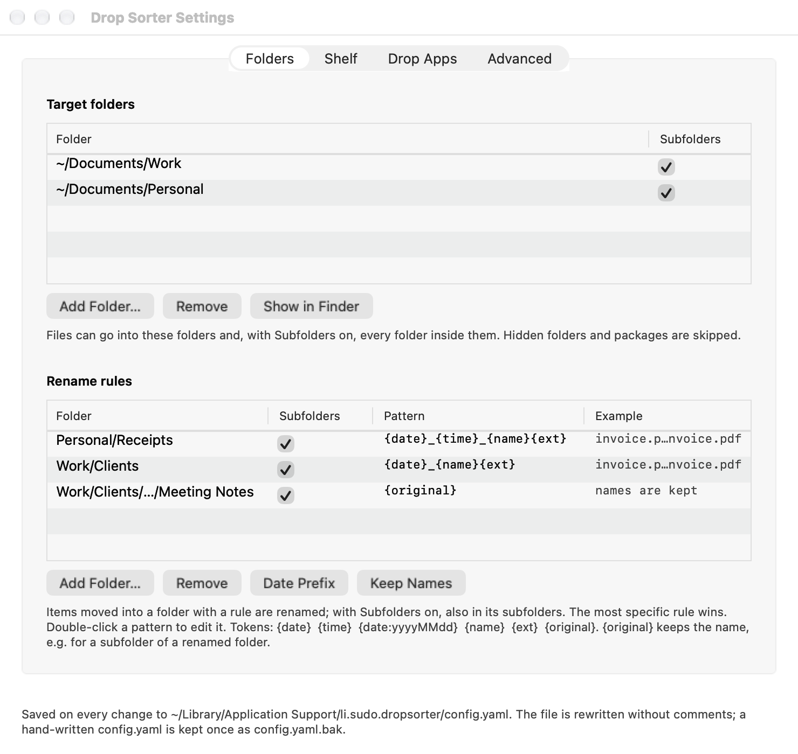
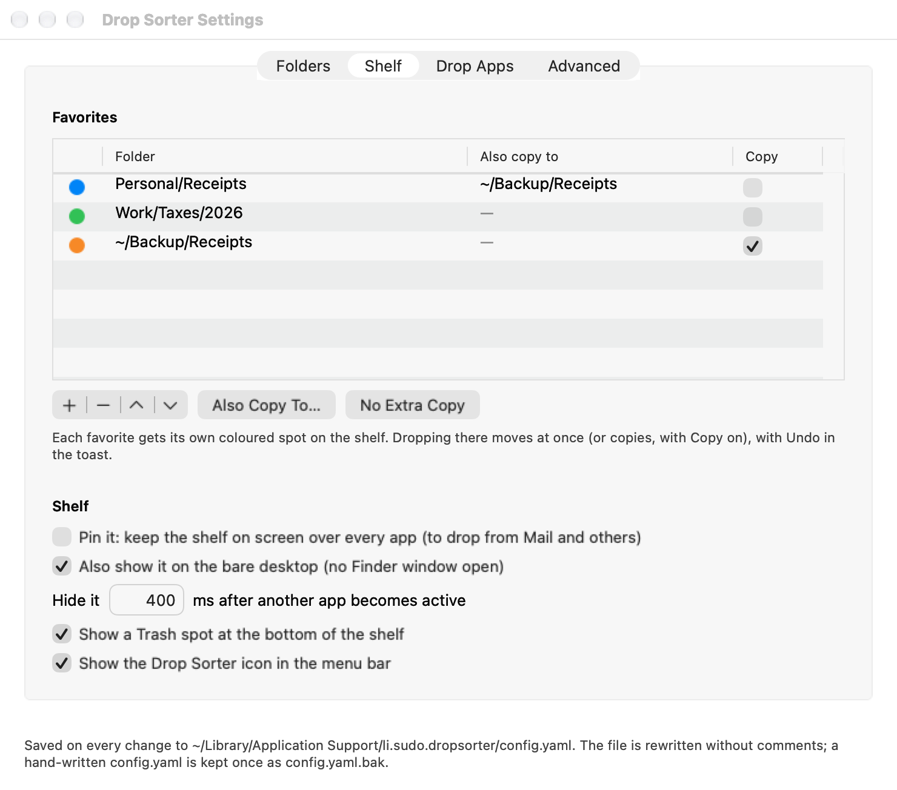
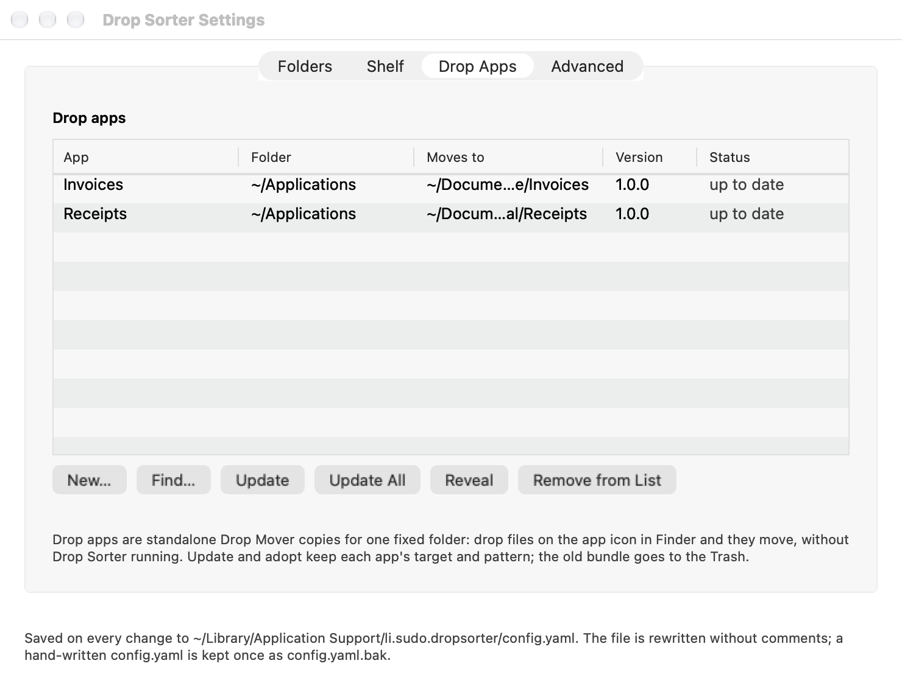
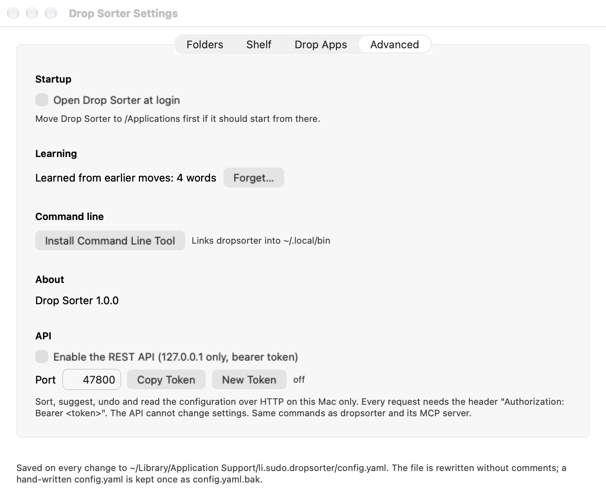

# Settings

Open Settings with the gear on the shelf, a right-click on the shelf, or the menu-bar icon. Every change
is saved at once to the [configuration file](configuration.md); the line at the bottom of the window says
where. A change that cannot be saved is refused with the reason in red above that line.

## Folders

**Target folders**: the folders files can go into.

- **Add Folder…**, **Remove**, **Show in Finder**.
- **Subfolders**: on (default), every folder inside can take files too; off, only the folder itself.
- Hidden folders (such as `.git`) and packages (such as apps) are never offered.

**Rename rules**: a pattern per folder, see [Rename rules](rename-rules.md).

- **Add Folder…**, **Remove**, **Date Prefix**, **Keep Names**; double-click a pattern to edit it.
- **Subfolders**: whether the rule also applies to the folders inside.
- **Example**: what `invoice.pdf` would be called, or what is wrong with the pattern.

## Shelf

**Favorites**: folders with their own spot on the shelf, see
[Favorites](shelf-and-chooser.md#favorites).

- The dot is the colour of the favorite's spot; the order here is the order on the shelf.
- **+** and **−** add and remove, the arrows change the order.
- **Copy**: this spot always copies instead of moving.
- **Also Copy To…** / **No Extra Copy**: a second folder that gets a plain copy, see
  [Also copy to](shelf-and-chooser.md#also-copy-to).

**Shelf**:

- **Pin it**: the shelf stays on screen over every app, see
  [Pin the shelf](shelf-and-chooser.md#pin-the-shelf). Same as the pin button on the shelf.
- **Also show it on the bare desktop**: off, the shelf shows only while a Finder window is open.
- **Hide it … ms after another app becomes active**: the delay before the shelf slides away
  (default 400).
- **Show a Trash spot at the bottom of the shelf** (default on).
- **Show the Drop Sorter icon in the menu bar** (default on). Without it, open Settings from the shelf.

## Drop Apps

The Drop Mover apps Drop Sorter knows about, with their folder, target, version and status. See
[Drop apps](drop-apps.md).

- **New…**, **Find…**, **Update**, **Update All**, **Reveal**, **Remove from List**.
- Double-click an app to reveal it in Finder.

## Advanced

- **Startup**: **Open Drop Sorter at login**. Move the app to Applications first: it starts from where
  it is.
- **Learning**: how many words Drop Sorter has learned from earlier moves; **Forget…** clears them.
- **Command line**: **Install Command Line Tool** links `dropsorter` into `~/.local/bin`, see
  [Automation](automation.md).
- **About**: the version of Drop Sorter.
- **API**: turn the REST API on or off, set the port, **Copy Token**, **New Token**. The text next to
  the buttons says whether it is listening, or why not. See [REST API](automation.md#rest-api).
