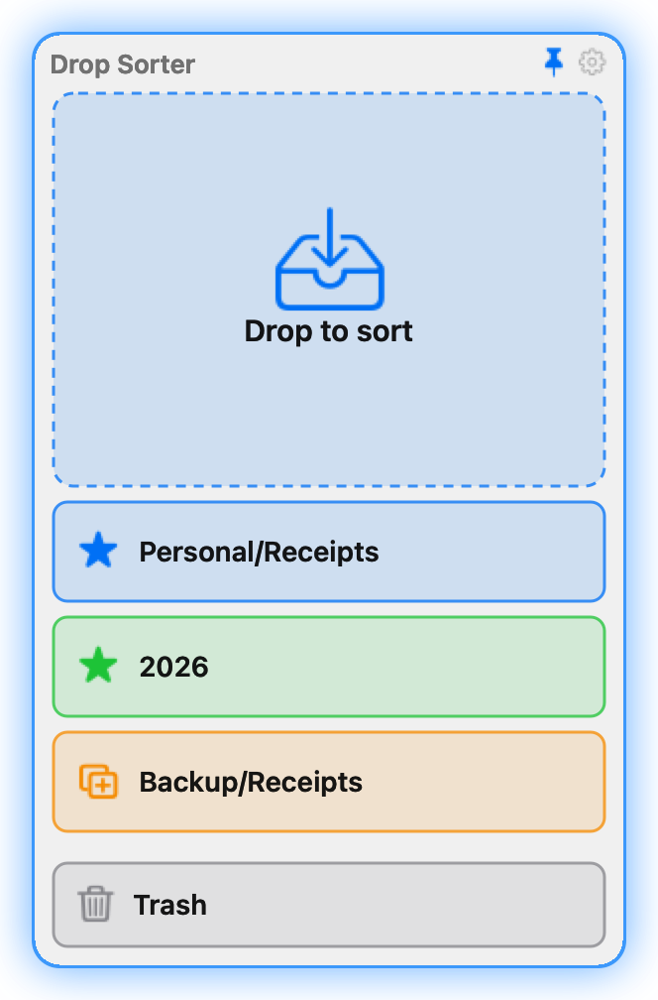
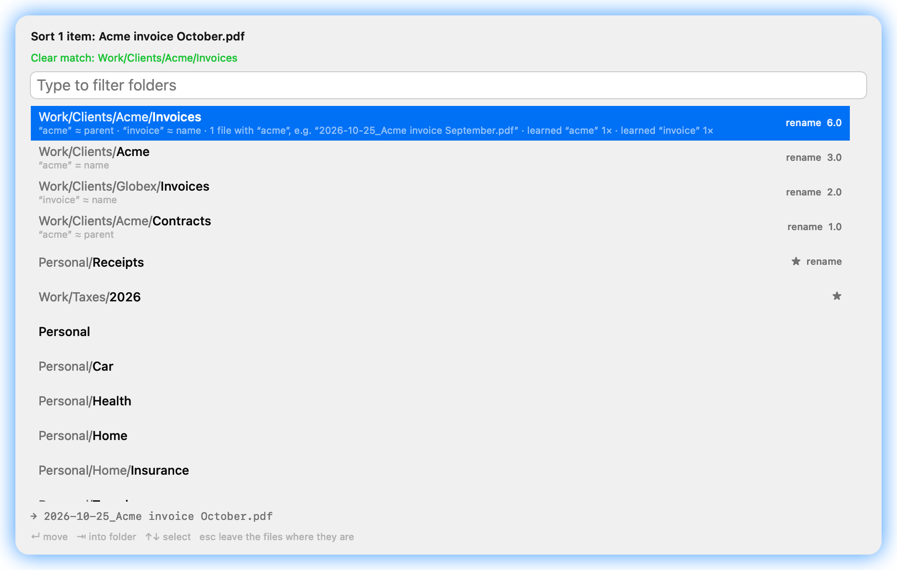

# The shelf and the chooser

## The shelf

The shelf pops up at the bottom right of the screen with the front Finder window while Finder is the
active app, and slides away shortly after another app becomes active (0.4 seconds by default, see [Settings](settings.md#shelf)).
It also shows over the bare desktop unless you turn that off.

When you open Drop Sorter (at launch, from Spotlight, Finder or the Dock, or with **Show Shelf** in the
menu-bar menu), the shelf shows even when Finder is not active, until you switch to another app than
Finder. ✕ next to its title hides it at once.

With several displays the shelf follows Finder: click a Finder window on another display and the shelf
moves there within a second. Over the bare desktop it stays where it was.

From top to bottom the shelf has:

- **The main spot**: drop here to choose a folder in the chooser.
- **Favorite spots**: one coloured spot per favorite; dropping there moves at once. A spot that always
  copies shows a copy symbol instead of the star.
- **The Trash spot** (can be turned off): moves the items to the Trash, with Undo.
- **The gear**: Settings. A right-click anywhere on the shelf opens the menu.

## Pin the shelf

To drop from other apps than Finder (Apple Mail, Photos, a browser), pin the shelf: click the pin at
the top of the shelf, or choose **Keep Shelf on Screen** in the menu. A pinned shelf shows a filled pin
and stays on screen over every app until you click the pin again. Drop Sorter remembers it across
restarts (`pinned` in the [configuration](configuration.md#shelf)).

## Dropping from Mail and other apps

Mail, Photos and some other apps do not hand over a file but promise one: the file is written only
when you drop it. Drop Sorter takes such items (Mail attachments, and whole messages as `.eml` files)
into a folder of its own, `Received` next to the configuration, and sorts them from there like any
other file:

- They are always moved out of `Received`, also with ⌥ or onto a favorite that copies. The original
  stays in the app you dragged from. The cursor shows a green + because the app gives a copy.
- Undo moves them back into `Received`. Emptied folders there are removed after a day.
- The Trash spot does not take them.

A right-click on the shelf and a click on the menu-bar icon open the same menu:

- **Show Shelf** (menu-bar icon only): shows the shelf until you switch to another app than Finder.
- **Keep Shelf on Screen**: pins the shelf, see [Pin the shelf](#pin-the-shelf).
- **Undo Last Drop**: says what it would undo, see [Undo](#undo).
- **Settings…**, **Open Configuration File**, **Drop Sorter Help**.
- The version, and **Quit Drop Sorter**.

## The chooser

Dropping on the main spot opens the chooser. It shows the dropped items, a line about the suggestion
("Clear match", "Unsure", "No hint in the name") and the list of folders, best match first.

- Each folder that matches shows its score and the reasons below its name, for example
  “acme” ≈ parent (see [How suggestions work](suggestions.md)).
- Folders with a rename rule show **rename**, and the line below the list previews the new names for
  the selected folder. Favorites show ★.
- With ⌥ held while dropping, the chooser says **Copy** instead of **Sort**, and Return copies.

| Key | Does |
|---|---|
| Typing | Filters the folders: every space-separated term must appear in the folder's path as one piece (`embr` finds `Cembra`). Matches at the start of a word come first. |
| ↑ ↓ | Select a folder |
| ⇥ (Tab) | Step into the selected folder: shows the folders inside it |
| Return | Move into the selected folder |
| Double-click | Move into that folder |
| Esc | Cancel: the items stay where they were |

A click outside the chooser also cancels. When the suggestion is not clear, nothing is selected, so a
blind Return never puts files in the wrong place.

With many folders the chooser may open with "Scanning the target folders…" for a moment. You can
already type; the list fills in when the scan is done, and Return waits for it. Drop Sorter starts the
scan as soon as you drag over the shelf, so usually the list is there when you drop. After Return the
chooser closes at once; the move runs in the background and the message follows when it is done.

## Favorites

Favorites are folders you use often. Each gets its own coloured spot on the shelf: dropping there moves
at once, without the chooser. Add, remove and order them in **Settings › Shelf**. A favorite can be any
folder, also one outside your target folders. A favorite whose folder is missing is shown dimmed and takes no drops.

## Copy instead of move

- Hold ⌥ (Option) while dropping: the items are copied, like in Finder (the cursor shows a green +).
- A favorite can be set to always copy (the **Copy** column in Settings › Shelf). Its spot shows a copy
  symbol.
- Undo of a copy moves the copies to the Trash. The originals are never touched.

## Also copy to

A favorite (or a drop app) can also put a plain copy of every dropped item into a second folder, for
example a backup. The copy keeps the original name: no rename rule, no further copies, so there are no
chains or loops. Identical files already in that folder are not copied again. Undo removes these copies
too. Set it with **Also Copy To…** in Settings › Shelf.

## Duplicates

Before moving, Drop Sorter compares each file by content with the files already in the target folder
(size first, then a SHA-256 checksum). A date prefix or another name does not hide a duplicate. Nothing
is ever overwritten: a name clash gets `-2`, `-3` and so on.

If an identical file is already there, an orange toast offers:

- **Undo**: put everything back where it was.
- **Delete Duplicates**: the new copies go to the Trash; the files that were there stay.
- **Keep Both**: leave everything as it is.

## Undo

- The toast after each drop has **Undo**. It stays while the pointer is over it; an error stays longer.
- **Undo Last Drop** in the shelf menu and the menu-bar menu undoes the most recent operation once,
  also after the toast is gone and also when some items of that drop failed. The menu item says what it
  would undo.
- Only the most recent operation can be undone, whether it came from a drop, the command line, an AI
  agent (MCP) or the REST API.

Moves go back to where they were; copies go to the Trash.

## Other ways to drop

- Drop files on the menu-bar icon: opens the chooser.
- Drop files on the Drop Sorter icon in Finder or the Dock: opens the chooser.
- [Drop apps](drop-apps.md): standalone apps for one fixed folder.
